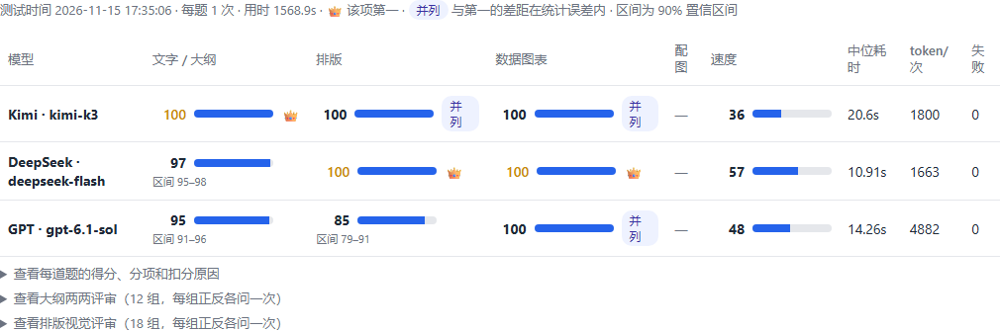
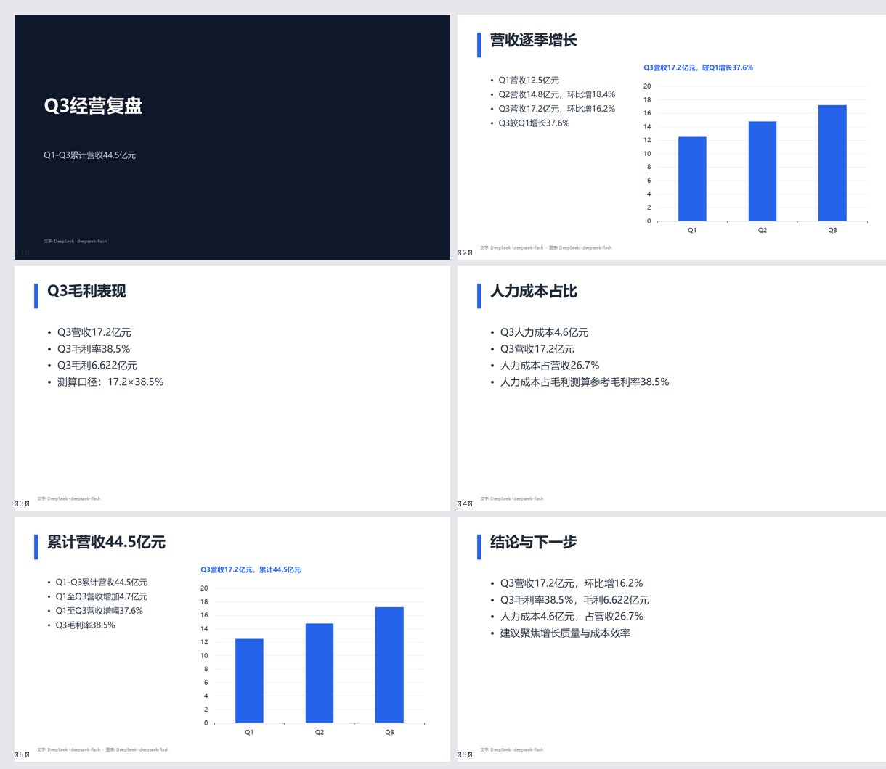
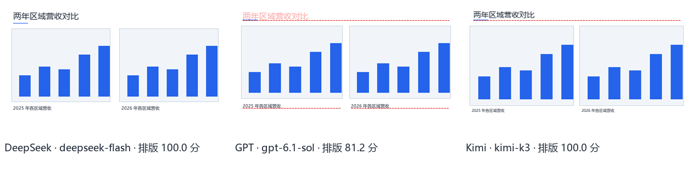

[简体中文](README.md)

# SlideArena · PPT Model Arena

> Use the API keys you already have to find the models best at writing outlines, laying out slides, making charts, and generating images, then let them work together on a PowerPoint deck.

There are many models and agents that can make PPTs. Trying each one by hand costs time and API quota. SlideArena automates the comparison and routing:

1. **Connect models**: add an API key for OpenAI, Claude, Gemini, DeepSeek, Kimi, Qwen, Doubao, Zhipu, SiliconFlow, OpenRouter, Ollama, or any OpenAI-compatible endpoint.
2. **Benchmark abilities**: have every model answer the same PPT task bank, score the results, and build a leaderboard.
3. **Delegate deck work**: give the outline to the strongest writing model, chart slides to the most accurate data model, and the cover image to an image-capable model. Apply one local theme and export an **editable** `.pptx`.

## Quick Start

Requires Python 3.9 or later.

```bash
pip install -e .
```

```bash
slidearena
```

The app opens at `http://127.0.0.1:8765`. To try the complete flow without an API key, click **Add 3 demo models**. The demo runs offline and costs nothing.

You can also use the command line:

```bash
slidearena add        # interactively add a model
slidearena bench      # benchmark models and print the leaderboard (-r 3 repeats each task three times)
slidearena selftest   # verify every reference answer still scores 100
slidearena make "Create a Q3 business review for leadership: revenue was 1.25B in Q1, 1.48B in Q2, and 1.72B in Q3" -n 6
```

<!-- BEGIN SAMPLE_RESULTS_EN -->
## Sample results

| Model | Text | Layout | Charts | Speed | Median latency | Tokens/call | Failures |
|---|---|---|---|---|---|---|---|
| DeepSeek · deepseek-flash | 97.2 (leader) | 100.0 (leader) | 100.0 (leader) | 59.2 (leader) | 10.18s | 2190 | 0 |
| GPT · gpt-6.1-sol | 93.7 (tied) | 84.9 (behind) | 100.0 (tied) | 37.1 (behind) | 19.74s | 5057 | 0 |
| Kimi · kimi-k3 | 95.8 (tied) | 100.0 (tied) | 100.0 (tied) | 20.4 (behind) | 32.55s | 1946 | 0 |

Test date: 2026-11-16 11:07:53; task bank: 2026.11-b (28 tasks, 6 hard); repeats per task: 1; outline review enabled (17 groups); visual layout review enabled (21 groups). Results represent this task bank on this day only.
<!-- END SAMPLE_RESULTS_EN -->

## Screenshots

| Leaderboard | Generated deck |
|---|---|
|  |  |

## What It Tests

The bank currently has 31 tasks, including 6 marked hard, each with a human-checked reference answer. Run `slidearena selftest` to make sure the scorer awards every reference answer 100 points; this guards against false penalties.

| Dimension | Tasks | What they test |
|---|---|---|
| Writing / outlines | Business reviews, pitch decks, school lessons, and a corrected sales report ×4, plus 2 hard reconciliation/contradiction outlines; condense source text into one slide ×3, plus 1 hard strict-length condensation | Use required facts, avoid unsupported numbers, catch corrected figures and rumors, distinguish percentage points from percentages, and follow slide/title/bullet limits |
| Data charts | Create charts from source material ×9, plus 2 hard multi-series and two-step margin charts | Exclude distracting totals, convert units, calculate growth and shares, sort values, select a period from a longer series, compare multiple series, and refuse to invent missing data |
| Layout | Chart page, hero image, four cards, dense text, two charts, a five-step timeline, and one hard tight-space layout ×7 | Keep elements in bounds and non-overlapping; **deduct text-fit points by overflow ratio**: required height divided by box height is full at 1.0, zero at 1.5, linear in between, with a 0.02-inch tolerance; keep card sizes consistent; give images enough area; place captions under their charts; order timeline steps |
| Images | Generate one cover image, for image-capable endpoints | Whether image generation succeeds |
| Speed | Median latency across text calls | Logarithmic score: 100 at 3 seconds or less, 0 at 60 seconds or more; each doubling costs the same number of points |

The new outline-revision tasks ask models to correct wrong figures, overlong titles or bullets, and incorrect slide counts. Error correction is worth 50 points, with the rest awarded for format, factual support, and required information. Scores are split into parts so reports can show where points were lost. For example, chart scoring separates values (55), categories (20), chart type (10), extra data (5), and takeaway accuracy (10).

### Number Checking

Every number in a model's answer is checked against the source. These are accepted as supported:

- An exact value or a unit conversion (71,000 ten-thousand yuan = 710 million yuan).
- A calculation from nearby values: differences, growth rates, ratios, totals and shares within a sentence, amount times percentage, or percentage-point changes.
- A value within the stated precision (for example, 18.4% accepts a true value from 18.35% to 18.45%).

Coarse values such as `41%` are marked unverifiable because a random guess can match too often; they neither lose points nor count as verified. Two-step calculations such as a growth rate minus a target are also marked unverifiable. Tests measure a 0–12% false-accept rate for random fabricated values (`tests/test_scoring.py`).

Some wrong figures appear in the source, such as an earlier corrected draft or an unverified rumor. These cases have explicit traps. A sentence that says an earlier value was corrected is not treated as an error.

Reasoning models may spend output tokens before writing their answer, so each task allows up to 12,000 output tokens. Truncated output is reported explicitly. When making a PPT, unsupported outline numbers trigger one rewrite; unsupported bullets are removed if the rewrite still fails the check.

### Pairwise Review

Rules can check formats and numbers, but not which outline tells a better story. A reviewer model compares two outlines; who reviews depends on how many models take part (see below). The reviewer sees both A/B orders; only matching verdicts count as a win, while inconsistent verdicts are ties. Bradley–Terry scores summarize the results, which contribute 25% of the outline score without changing the overall average.

### Any Number of Models

You do not need a fixed number of models. The review method adapts to how many take part:

| Models | Pairwise review |
|---|---|
| 1 | Nothing to compare: rule scores only. The leaderboard shows absolute scores (reference answer = 100) and no "leader". |
| 2 | No third model can judge, so pairwise review is skipped and scores are rule-based (models never judge themselves). Pairwise review is only 25% of a dimension; rule scores still decide the ranking. |
| 3 or more | Each pair is reviewed by a model outside it, so no model judges itself. Reviews go to the least-loaded judge first. |
| 5 or more | Each task compares one **balanced round** of pairs (every model 1–2 times), rotating across tasks so the bank covers every pair. Each model's review cost stays flat as the number of models grows. |

Before a run, every model's connection is checked in parallel. Unreachable models are left out and listed on the leaderboard, so one wrong key does not slow down the whole run. The web app shows the planned calls and review method as you pick models; `slidearena bench` prints the same plan first.

### Layout Screenshot Review

Rules can check bounds, overlaps, and text fit, but not visual quality. SlideArena renders each model's coordinates and font sizes into a 960×540 screenshot, wraps text at its font size, marks text that fails the shared fit rule in red, and draws charts as placeholder bars. A third-party vision model compares two screenshots in both orders. The result contributes 25% of the layout score. Set `"vision": false` in a model's configuration to exclude it from visual review.

```bash
slidearena bench --only layout      # benchmark only layout, including screenshot review
```

```bash
slidearena bench --no-visual        # skip screenshot review
```



### Rate Limits

On HTTP 429 responses, SlideArena reads the provider's RPM and concurrency limits when available, queues retries, and excludes queue time from model latency. You can also set `"rpm": 3, "max_concurrency": 2` in a model configuration. Tasks that remain rate-limited are recorded as unscored rather than zero; a different reviewer is tried if a judge is rate-limited.

### Confidence

- Use `-r 3` to repeat tasks and average each task's results.
- Every score includes a 90% confidence interval computed by bootstrap resampling across cases.
- Scores within the statistical margin of the leader are marked tied.

Chart tasks mainly screen out models with weaker chart skills and offer limited separation among top models. When every model scores perfectly on these tasks, outline pairwise reviews and visual layout reviews provide most of the distinction.

### Model Routing

For each kind of work, routing first keeps models statistically tied with the leader and with a failure rate below 20%. Among those, it considers score, token cost, and latency. You can prefer quality, low cost, or speed. When two models both score perfectly, the cheaper or faster one wins rather than an arbitrary choice.

## Current Limitations

- Image tests check whether generation succeeds; they do not assess image quality.
- Layout screenshots use a simplified renderer and do not represent PowerPoint's actual rendering.
- Review models can have preferences. Reversed prompts and a third-party judge reduce position and self-review bias but cannot eliminate subjectivity.
- The task bank currently has 31 tasks, including 6 hard tasks with unit traps, two-step calculations, multi-series charts, strict word limits, and tight layouts, plus 2 outline-revision tasks; it is still focused mainly on Chinese business scenarios.

## Privacy

- The service listens only on `127.0.0.1`. Keys are stored locally in `~/.slidearena/models.json`; set `SLIDEARENA_HOME` to change the data directory.
- Write a key as `env:DEEPSEEK_API_KEY` to keep its value out of the model configuration file.
- Windows PowerShell: `$env:DEEPSEEK_API_KEY="your-api-key"`
- macOS: `export DEEPSEEK_API_KEY="your-api-key"`
- Linux: `export DEEPSEEK_API_KEY="your-api-key"`
- Enter `env:DEEPSEEK_API_KEY` in the model's API Key field. The environment variable is available to that process and its child processes.
- The web app and reports show only masked keys. Requests go only to the model providers you configure.

## Project Structure

```
slidearena/
  llm.py        Model adapters (OpenAI-compatible, Anthropic, and offline demo); standard library only
  cases.py      Task bank, reference answers, and prompts
  scoring.py    Deterministic scorers and explanations
  facts.py      Number checking, unit conversions, and precision tolerances
  render.py     Render layout answers for visual review
  stats.py      Bootstrap intervals, tie detection, and Bradley–Terry ratings
  benchmark.py  Benchmark runs, pairwise reviews, profiles, and routing
  deck.py       Route outline/chart/image work and create editable PPT files with python-pptx
  server.py     Local web server and API
  static/       Web interface
tests/test_scoring.py  Scoring tests: references, common mistakes, and false-accept rate
tests/smoke_test.py    End-to-end tests using local fake API servers
```

Run the tests:

```bash
python tests/test_scoring.py
python tests/smoke_test.py
python -m slidearena selftest
```

## Roadmap

- [ ] Compare 2–3 variants side by side for an uncertain slide and let the user choose.
- [x] Compare rendered layout screenshots with vision models and include the results in layout scores.
- [ ] Extend screenshot review to real PowerPoint-rendered slides using PowerPoint or LibreOffice.
- [ ] Add process diagrams, comparison slides, speaker notes, and content/design/coherence measures from PPTEval.
- [ ] Connect local agent CLIs (such as Codex and Claude Code in non-interactive mode) and MCP services (such as Presenton and PPTAgent).
- [ ] Let users opt in to sharing anonymous benchmark results for a community PPT model leaderboard.

## License

MIT
