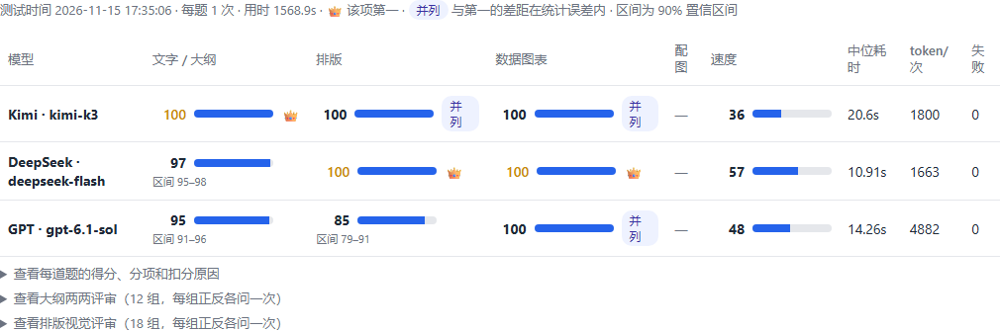
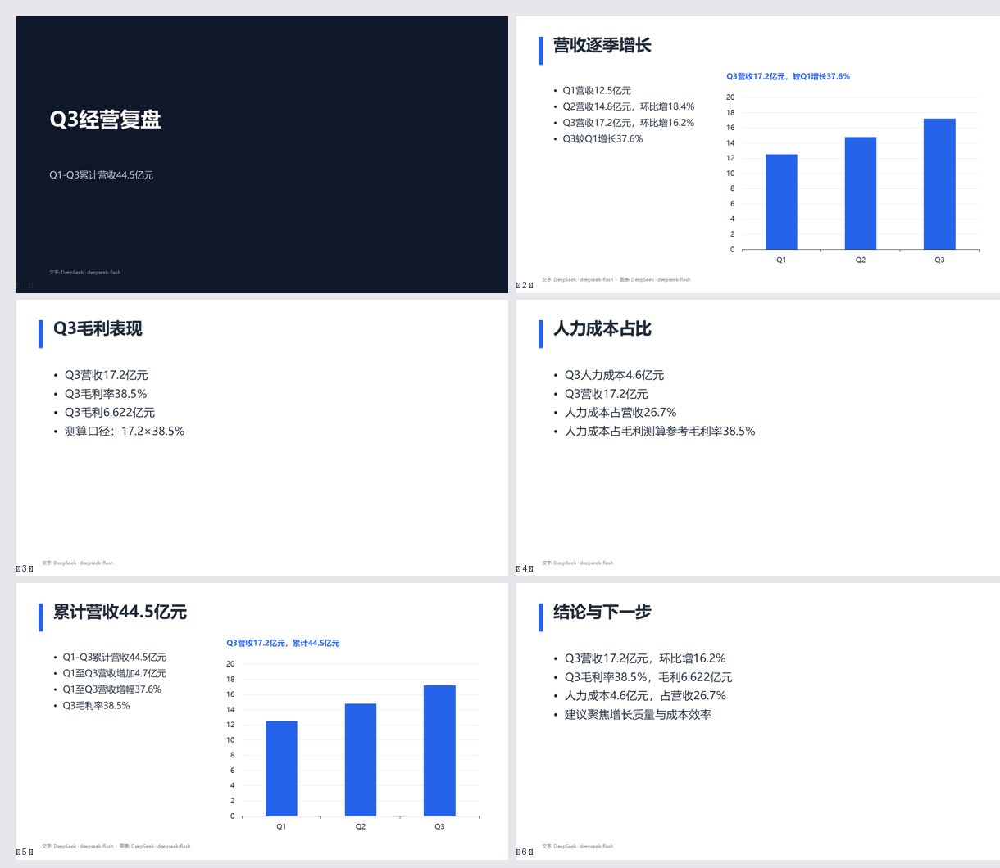
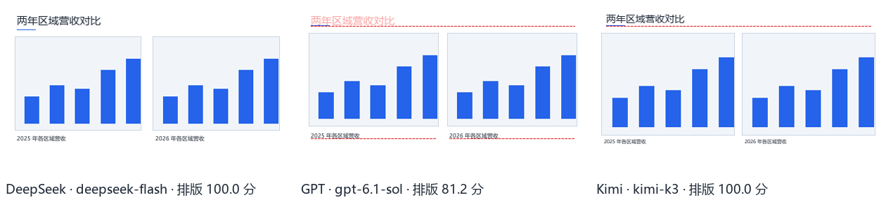

[English](README.en.md)

# SlideArena · PPT 擂台

> 用你**已有的 API Key**，一键测出哪个模型最会写大纲、最会排版、最会做图表、最会配图，然后让它们**分工合作**做出一份 PPT。

市面上能做 PPT 的模型和 agent 太多，挨个试既费时间又费额度。SlideArena 帮你把这件事自动化：

1. **接入模型**：填上 API Key 就行，支持 OpenAI、Claude、Gemini、DeepSeek、Kimi、通义、豆包、智谱、硅基流动、OpenRouter、Ollama，以及任何 OpenAI 兼容接口。
2. **能力测试**：所有模型做同一套 PPT 题目，自动打分，生成排行榜。
3. **分工制作**：大纲交给文字最强的模型，图表页交给数据最准的模型，封面图交给画图最好的模型，最后在本地统一主题，导出**可编辑**的 .pptx。

## 快速开始

需要 Python 3.9+。

```bash
pip install -e .
```

```bash
slidearena
```

浏览器会打开 `http://127.0.0.1:8765`。还没有 Key 的话，点"先加 3 个演示模型"，就能离线跑通全部流程（不联网、不花钱）。

也可以只用命令行：

```bash
slidearena add        # 交互式添加模型
slidearena bench      # 运行能力测试，打印排行榜（加 -r 3 每题跑 3 次，更稳）
slidearena selftest   # 评分器自检：所有参考答案必须拿满分
slidearena make "给管理层做 Q3 经营复盘：营收 Q1 12.5 亿、Q2 14.8 亿、Q3 17.2 亿" -n 6
```

<!-- BEGIN SAMPLE_RESULTS_ZH -->
## 实测结果示例 / Sample results

| 模型 | 文字 | 排版 | 数据图表 | 速度 | 中位耗时 | token/次 | 失败数 |
|---|---|---|---|---|---|---|---|
| DeepSeek · deepseek-flash | 97.2 (第一) | 100.0 (第一) | 100.0 (第一) | 59.2 (第一) | 10.18s | 2190 | 0 |
| GPT · gpt-6.1-sol | 93.7 (并列) | 84.9 (落后) | 100.0 (并列) | 37.1 (落后) | 19.74s | 5057 | 0 |
| Kimi · kimi-k3 | 95.8 (并列) | 100.0 (并列) | 100.0 (并列) | 20.4 (落后) | 32.55s | 1946 | 0 |

测试日期：2026-11-16 11:07:53；题库版本：2026.11-b；题库题数：28（难题 6 道）；每题重复次数：1；大纲评审：开启（17 组）；排版视觉评审：开启（21 组）。结果只代表这套题库在这一天的表现。
<!-- END SAMPLE_RESULTS_ZH -->

## 界面截图

| 排行榜 | PPT 结果 |
|---|---|
|  |  |

## 测什么，怎么打分

题库共 31 道题（其中 6 道标为 hard），每道都附有人工核对过的参考答案。运行 `slidearena selftest` 会用评分器给参考答案打分，必须全部 100 分，用来证明评分器不会误扣正确答案。

| 维度 | 题目 | 考察的难点 |
|---|---|---|
| 文字 / 大纲 | 经营复盘、融资路演、高中课件、带更正数字的销售月报 ×4，加上复核数字和前后矛盾资料的 hard 大纲 ×2；把一段话压缩成一页 ×3，加上严格字数限制的 hard 精简 ×1 | 资料里的关键数字和名词有没有用上；有没有编造资料里没有的数字；有没有误用已被更正的旧数字或未经核实的传闻；"个百分点"有没有被错写成"%"；页数、标题、要点长度和资料口径 |
| 数据图表 | 从资料做图 ×9，加上多系列对比和两步毛利率计算的 hard 图表 ×2 | 混入去年总额、员工数等干扰数字；万元和亿元混用要换算；要自己算增长率、占比、毛利率并排序；只取长序列中的一段并去掉预测值；资料里没有数据或缺一个数据点时，必须拒绝而不是编造或猜测 |
| 排版 | 图表页、大图页、四卡片、密集文字页、双图对比、五步时间轴，以及 1 道高难空间题 ×7 | 元素不越界、不重叠；**文字放得下按超出比例扣分**：需要高度与文本框高度之比不超过 1.0 得满分，达到 1.5 得 0 分，中间线性递减，并给 0.02 英寸容差；卡片大小一致、配图面积够大；说明文字紧贴在对应图表下方；时间轴按顺序排成一行 |
| 配图 | 1 张封面图（仅限能出图的接口） | 能否成功生成 |
| 速度 | 所有文字类调用的中位耗时 | 按对数计分：3 秒以内 100 分，60 秒 0 分，耗时每翻一倍扣分相同 |

新增的大纲改错题要求模型在原稿上纠正错误数字、超长标题/要点或错误页数；错误修正占 50 分，其余按格式、数字可信和关键信息保留评分。每道题的得分都拆成分项（例如图表题分为 数值 55 / 分类 20 / 类型 10 / 无多余数据 5 / 结论准确 10），报告页可以看到每一分扣在哪里。

### 数字核查

模型写的每个数字都会和资料比对，以下情况都算有依据：

- 原样出现，或换了单位（71,000 万元 = 7.1 亿元）；
- 由相邻数字算出：差值、增长率、比例、同一句里几项的合计和占比、金额乘百分比、百分点变化；
- 按写出的精度比对：写"18.4%"，真实值在 18.35–18.45 之间都算对。

对于"41%"这种精度太粗的数字，随机编一个也很容易碰巧对上，所以标为"无法核实"，既不扣分也不算正确。需要两步才能算出的数字（例如先算增长率再和目标相减）也归为"无法核实"。用随机编造的数字实测，误放行率在 0–12% 之间（见 `tests/test_scoring.py`）。

有些错误数字本身就在资料里，例如已被更正的初稿数字、未经核实的传闻，通用核查查不出来。这类题目会单独列出"陷阱"，模型用了就扣分；如果同一句里说明了"初稿 8.6 亿已更正"，则不算错。

思考型模型会先消耗输出 token 再作答，所以每道题给 12000 token 的上限。如果仍然被截断，报告会写明"输出被截断"，不会只显示"解析失败"。

做 PPT 时也会用这套核查：大纲里有依据不足的数字时，先让模型改写一次；改写后仍然没有依据，就删掉那条要点。

### 对比参考答案评审

规则只能检查格式和数字，判断不了"哪份大纲讲得更好"。所以每份大纲还会和这道题的人工参考答案放在一起，交给**另一个模型**盲评：评审只看到 A、B 两份，不知道哪份是参考答案，并且交换顺序再问一次。两次结论一致才算数，不一致就算持平，以此抵消评审偏向先看到那份的倾向。

结果只影响被评的那道题：胜过参考答案加 12.5 分（满分封顶），持平不变，不如参考答案减 12.5 分，相当于这道题 25% 的分数由评审决定。排行榜会同时显示"规则分"和"对比参考"（50 = 与参考答案持平）。

为什么和参考答案比，而不是模型之间两两比：参考答案是固定的标尺，所以**一个模型的分数不受同场对手影响**，不同批次、不同用户的结果可以直接比较；每个模型只需 2 次评审调用/题，开销不随模型数量增长；只有 2 个模型时也能互为裁判，且没有模型评自己的答案。

### 接入几个模型都能一键开测

不需要凑够固定数量的模型：

| 参加的模型 | 评审方式 |
|---|---|
| 1 个 | 没有其他模型当裁判，只按规则评分；排行榜显示绝对分（参考答案 = 100），不标"第一" |
| 2 个及以上 | 每份答案由另一个模型对比参考答案评审，评审任务平摊给工作量最少的模型，模型不评自己 |

开测前会并行检查所有模型的连接，连不上的模型自动排除并在排行榜上注明，不会因为一个 Key 填错而拖慢整轮测试。网页上勾选模型时会实时显示本次的调用次数和评审方式；命令行 `slidearena bench` 也会先打印这份计划。

### 排版截图视觉评审

规则只能判断排版是否越界、重叠、放得下，判断不了版面好不好看。所以系统会把每个模型给出的坐标和字号渲染成一张 960×540 的页面截图：文字按真实字号换行，溢出文本框的部分画成红色，图表位置画成占位柱状图。然后把它和参考答案的截图一起交给另一个能看图的模型盲评，同样正反各问一次，计分方式同上。不能看图的模型可以在配置里写 `"vision": false`，这样就不会被选作视觉评审。

```bash
slidearena bench --only layout      # 只测排版（含截图评审）
```

```bash
slidearena bench --no-visual        # 跳过截图评审
```



### 限流

有些账号每分钟只允许几次请求。遇到 429 限流时，系统会从服务商的提示里读出真实的每分钟次数和并发上限，然后排队重试；排队时间不计入模型耗时。也可以在模型配置里直接写 `"rpm": 3, "max_concurrency": 2`。多次重试仍被限流的题记为"限流未计分"，不按 0 分计入；评审裁判被限流时，会自动换一个裁判。

网络超时、连接中断、服务商 5xx 等故障也一样：重试 3 次仍失败的题记为"故障未计分"，不算模型答错。只有模型自己的问题（输出不是合法 JSON、被截断、答错）才扣分。某个模型超过 20% 的题没有计分时，排行榜会标红提醒，分工时也不会选它。

### 统计可信度

- 模型每次输出都不一样，可以用 `-r 3` 让每道题跑 3 次取平均。
- 每项分数都附带 90% 置信区间，用题目层面的 bootstrap 重抽样算出。
- "并列 / 落后"用一次覆盖**所有模型、所有配对**的置换检验判定（Westfall–Young max-T：在每道题内打乱模型标签，看最大的配对差距能有多大）。只有明显落后于至少一个模型时才标"落后"，否则标"并列"。

为什么不能简单地拿每个模型和第一名逐个比：第一名本身是从多个带噪声的分数里挑出的最高分，逐个比较的次数又随模型数增加。模拟显示，10 个实力完全相同的模型用逐个比较，约 90% 的测试会误判有人"落后"；现在的方法在 2–10 个模型、7–30 道题下误判率都稳定在约 10%（`tests/test_scoring.py` 每次都会重新模拟验证）。

数据图表题主要用来筛选图表能力不足的模型，对顶级模型的区分度有限。当这些题所有模型都能拿满分时，模型之间的主要差异来自大纲和排版的参考答案对比。

### 智能分工

做 PPT 时，每类任务按以下规则选模型：

1. 只保留排行榜上没有"落后"（与排行榜用同一个检验，结论一定一致）、失败率和未计分率都低于 20% 的模型；
2. 在这些模型中，综合分数、单次 token 消耗和延迟选一个。也可以指定只看质量、最省或最快。

所以两个模型都是满分时，系统会选更便宜、更快的那个，不会随便挑一个。

## 当前限制

- 配图只测试接口能否成功生成，不评估画面质量。
- 排版截图由简化渲染器生成，不代表 PowerPoint 的真实显示效果。
- 评审模型可能带有偏好；系统通过盲评、正反两问和不评自己降低偏差，但不能完全消除主观性。不同裁判的宽严程度不同，模型少时（例如 2 个模型互为裁判）影响更明显。
- 对比参考答案时，胜过参考答案的加分在满分处封顶：多个顶级模型都满分且都胜过参考答案时，暂时分不出高下，需要更难的题目。
- 题库目前有 31 道题，其中 6 道 hard 题专门增加单位陷阱、两步计算、多系列图表、严格字数和紧张空间布局；另有 2 道大纲改错题，以中文商务场景为主。

## 隐私

- 服务只监听 `127.0.0.1`，Key 只保存在本机的 `~/.slidearena/models.json` 中（可以用环境变量 `SLIDEARENA_HOME` 改位置）。
- Key 可以写成 `env:DEEPSEEK_API_KEY`，这样文件里不存明文。
- Windows PowerShell：`$env:DEEPSEEK_API_KEY="你的 API Key"`
- macOS：`export DEEPSEEK_API_KEY="你的 API Key"`
- Linux：`export DEEPSEEK_API_KEY="你的 API Key"`
- 然后在模型配置的 API Key 一栏填写 `env:DEEPSEEK_API_KEY`；环境变量只对设置它的进程及其子进程可见。
- 网页和测试报告里只显示脱敏后的 Key。
- 请求只会发给你自己配置的模型服务商。

## 项目结构

```
slidearena/
  llm.py        模型适配器（OpenAI 兼容 / Anthropic / 离线演示模型），只用标准库，失败自动重试
  cases.py      题库、参考答案和提示词
  scoring.py    各题型的评分器（分项计分并给出扣分原因）
  facts.py      数字核查：单位换算、常见推算、精度容差
  render.py     把排版坐标渲染成页面截图，供视觉评审
  stats.py      bootstrap 置信区间、覆盖所有配对的置换检验（并列 / 落后）
  benchmark.py  测试流程、对比参考答案评审、能力画像、智能分工
  deck.py       按分工生成大纲和图表，核查数字，用 python-pptx 渲染可编辑 PPT
  server.py     本地网页服务和接口
  static/       网页界面
tests/test_scoring.py  评分方法单元测试：正确答案满分、典型错误被识别、误放行率
tests/smoke_test.py    用本地假 API 服务跑完整端到端测试
```

运行测试：

```bash
python tests/test_scoring.py
```

```bash
python tests/smoke_test.py
```

## 路线图

- [ ] 逐页赛马：拿不准的页让 2–3 个模型各做一版，并排对比，点选胜者
- [x] 渲染截图后用视觉模型与参考答案对比评审，结果计入排版得分
- [ ] 截图评审扩展到整份生成的 PPT（用 PowerPoint 或 LibreOffice 渲染真实页面）
- [ ] 更多题型：流程图、对比页、演讲备注；接入 PPTEval 的内容、设计、连贯性维度
- [ ] 接入本地 agent CLI（Codex、Claude Code 等的非交互模式）和 MCP 服务（Presenton、PPTAgent）
- [ ] 用户自愿匿名上传测试结果，汇总成社区"PPT 模型排行榜"

## License

MIT
